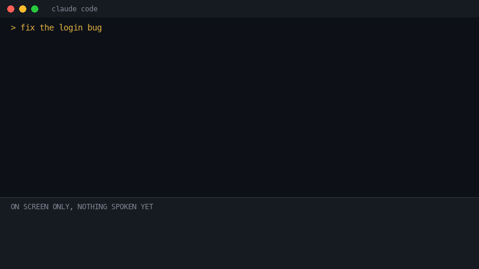
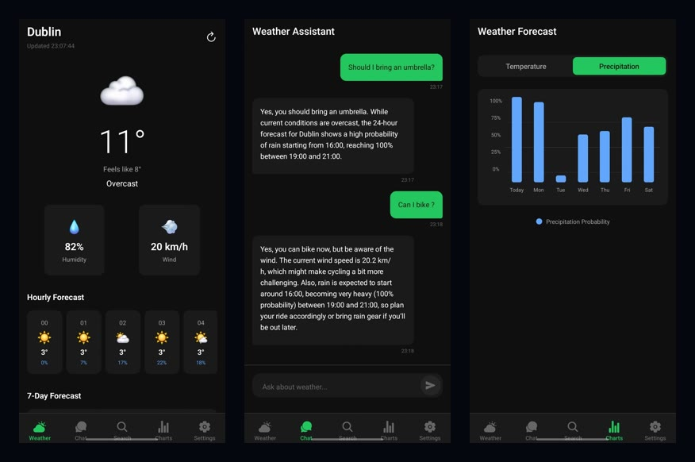

<p align="center">
  
</p>

<p align="center">
  Hi, I'm Hari. I build AI products that real people use.<br>
  <a href="https://www.linkedin.com/in/hari-krishnan-a-561a6427b">▶ LinkedIn</a> &nbsp; <a href="mailto:harikrishnan.a.official@gmail.com">▶ Email</a>
</p>

## 🧑‍🚀 PLAYER BIO


Hari here. I want AI to make everyday life better for people, not more complicated.

That outlook is what pulled me into a BTech in AI, and then kept me going through an MSc in it.

Now I'm a **Forward Deployed Engineer at Neuramodal** and an **Applied AI Engineer at Psynapse** in Dublin, building towards it every day. Away from the keyboard, I'm at the gym or on a weekend side quest around Dublin, usually getting rained on.

<br clear="right">

## 🕹️ SELECT YOUR LOADOUT

<p align="center">
  
</p>

<p align="center"><b>🤖 AI ARSENAL</b></p>

<p align="center">
        
</p>

<p align="center"><b>⭐ POWER-UPS COLLECTED</b></p>

| Power-up | What it actually does |
|---|---|
| 🍄 Multi-tenant sales agents | One Gemini agent, many shops, each answering from its own catalogue on GCP |
| 🔊 Offline voice | Kokoro speaks and Whisper listens, both on a laptop CPU, no cloud |
| 👁️ Shelf vision | YOLO spots gaps on supermarket shelves so a robot can refill them |
| 🛡️ Bug shield | Security fixes ship with the test that proves the hole stays shut |

## 🌦️ A DAY IN MY LIFE

<p align="center">
  
</p>

<p align="center">
  🟢 <b>Forward Deployed Engineer @ Neuramodal</b> &nbsp;·&nbsp; 🟢 <b>Applied AI Engineer @ Psynapse</b><br>
  <sub>Both, right now. Started from an MSc in AI at National College of Ireland.</sub>
</p>

## 👾 SIDE QUESTS

### 🎙️ [Jarvis Voice](https://github.com/Hari-K-Dev/jarvis-voice)

When Claude Code finishes, a British voice gives me the gist in two sentences. It never reads out the stack trace. `Python` `Claude Haiku` `Kokoro`

<p align="center">
  <a href="https://github.com/Hari-K-Dev/jarvis-voice"></a>
</p>

<p align="center"><a href="https://github.com/Hari-K-Dev/jarvis-voice"><b>▶ PLAY IT: github.com/Hari-K-Dev/jarvis-voice</b></a> &nbsp;·&nbsp; open source, MIT</p>

### 📝 Teachward

Teachers upload an old test and get a new one back in their school's format. Early days. `Next.js` `Supabase` `Claude`

<p align="center">
  
</p>

### 🌦️ Weather app

Dublin kept lying to me about sunshine, so I built an app that tells me whether to bike. `FastAPI` `React` `Gemini` `Qdrant`

<p align="center">
  
</p>

## 🔁 DAILY LOOP


```python
while True:
    code()                   # most of the day
    build(something_fun)
    gym()
    if weekend():
        side_quest("Dublin")  # bring a jacket
```

<br clear="right">

<details>
<summary><b>🎖️ ACHIEVEMENTS</b> (tap to open)</summary>
<br>

⚡ Cut a 70-second AI call down to 3<br>
🛡️ Patched path traversal and IDOR bugs, with tests<br>
🤖 Built a robot that restocks supermarket shelves

</details>

## 📊 STATS

<p align="center">
  
</p>

## 🐍 BONUS LEVEL

<picture>
  <source media="(prefers-color-scheme: dark)" srcset="https://raw.githubusercontent.com/Hari-K-Dev/Hari-K-Dev/output/snake-dark.svg">
  
</picture>

<p align="center">
  
</p>

<p align="center">
  <a href="https://www.linkedin.com/in/hari-krishnan-a-561a6427b"></a>&nbsp;
  <a href="mailto:harikrishnan.a.official@gmail.com"></a>&nbsp;
  <a href="https://github.com/Hari-K-Dev"></a><br>
  <sub>coffee: unresolved · dublin weather: undefeated · iron man suit: out of scope</sub>
</p>
